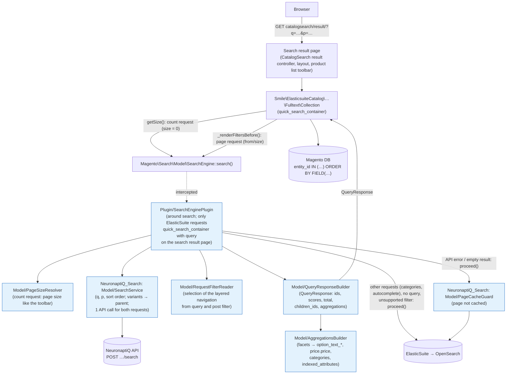

# NeuronaptiQ_SearchElasticsuite

Smile ElasticSuite integration of the **NeuronaptiQ** semantic search. The search result page of shops
running ElasticSuite shows the products, the total and the filters of the layered navigation (facets) from the
NeuronaptiQ API.

The module only contains the adaptation layer for ElasticSuite. Everything else (API client, configuration,
search logic, search suggestions, cross-sellings, tracking) comes from the main module `NeuronaptiQ_Search`.

- Composer package: `neuronaptiq/magento-search-elasticsuite`
- Magento module: `NeuronaptiQ_SearchElasticsuite`, namespace `NeuronaptiQ\SearchElasticsuite`
- License: MIT

## Requirements

- `NeuronaptiQ_Search` 2.1.0 or newer (filters and facets)
- For the filters of the search result page: a search service with filters, facets and price ranges, see
  *Layered navigation* in the README of `NeuronaptiQ_Search`
- Smile ElasticSuite 2.11 (developed against 2.11.15.1 on Magento 2.4.8-p5)
- PHP 8.2 – 8.5

Install it only in shops running ElasticSuite: the module uses ElasticSuite classes, so `setup:di:compile`
fails without ElasticSuite.

## Installation

Via Composer:

```bash
composer require neuronaptiq/magento-search-elasticsuite
bin/magento module:enable NeuronaptiQ_Search NeuronaptiQ_SearchElasticsuite
bin/magento setup:upgrade
bin/magento setup:di:compile
bin/magento cache:flush
```

Manual installation from the zip package: extract it in the Magento root, it contains
`app/code/NeuronaptiQ/SearchElasticsuite/`, then run the same `bin/magento` commands.

## Configuration

None. The module uses the settings of `NeuronaptiQ_Search` (*Stores → Configuration → NeuronaptiQ*); with
*Enable Search* switched off, ElasticSuite searches as usual. It logs via the logger of `NeuronaptiQ_Search`
(own log file `var/log/neuronaptiq.log` or the Magento logger, switch *Separate Log File*).

## How it works

The ElasticSuite product collection of the search result page does not use Magento's `SearchInterface`, it
calls `Magento\Search\Model\SearchEngine::search()` directly with its own requests:

- the page: request `quick_search_container` with `from`/`size` and the sort order; the collection loads the
  returned product ids in the order of the response
- the count: the same request with `size = 0`, only for the total and the attribute counts of the layered
  navigation (`indexed_attributes`, also used for the coverage of the filters); it can come before the page
  request

Code flow of the search result page (classes of this module and of `NeuronaptiQ_Search` highlighted, dashed
arrow = plugin interception; the search suggestions are handled by `NeuronaptiQ_Search` alone):



`Plugin/SearchEnginePlugin` (around `SearchEngine::search`) answers both requests:

1. Only ElasticSuite requests named `quick_search_container` with a query (`q`) on the search result page
   (action `catalogsearch_result_index`) are handled, while the search is enabled. Category pages, product lists
   and the autocomplete are passed on, also when a setup configures the autocomplete product collection with
   `quick_search_container` (its product suggestions come from the suggest API of `NeuronaptiQ_Search`).
   Requests for more than 100 products per page (`NeuronaptiQ\Search\Model\SearchService::MAX_LIMIT`, the API
   maximum) are no page of the product list: a filter calls `getFacetedData()` before the toolbar sets the page
   size, and the collection then requests all hits (`getPageSize()` falls back to `getSize()`). They are answered
   like the count request with the hits of the current page, so their facets match the selection; the product
   list is requested afterwards.
2. The selection of the layered navigation is read from the request (`Model/RequestFilterReader`, see
   *Layered navigation* below). A filter the API cannot apply leaves the request to ElasticSuite (cacheable,
   debug log entry).
3. The search runs via `NeuronaptiQ\Search\Model\SearchService` of the main module: query, page and sort order
   from the URL, page size from the request (count request: page size of the product list, resolved like the
   toolbar by `Model/PageSizeResolver`, so that both requests use the same API result), the selection and the
   facet request. Variants are mapped to their parent product.
4. `Model/QueryResponseBuilder` converts the result into ElasticSuite's `QueryResponse` (built from an array in
   the format of an Elasticsearch response) with the API `total` and the facets as aggregations (only those the
   request asks for); the count request gets no hits. Each hit gets the hit children of the API (`childrenIds` of
   `SearchService`, with the variant mode "best" the best matching variant) as `children_ids`: with a swatch filter
   (e.g. color) ElasticSuite shows the image of the child product among them that matches the selection, without
   them its fallback fails for a multiselect selection. If none matches, the image of the parent product is shown.
5. On API errors and an empty first page (the API also answers requests it classifies as bots with an empty
   result), ElasticSuite searches as usual and the page is excluded from the full page cache
   (`NeuronaptiQ\Search\Model\PageCacheGuard`). An empty later page has no fallback (paged too far). For pages
   beyond the API's result pool the API returns `total` 0; the count request then uses the total of the first
   page, so the result page reports the real number of hits instead of "no results". A selection without hits
   is a real result: the page stays empty with the facets, so the selection can be removed.
6. Spellcheck note: before the search, ElasticSuite checks the spelling of the query against its own index.
   Terms that are not in the index (e.g. semantic queries, or German terms in an English catalog) are
   classified as misspelled, and the result page shows "No exact results found for … The displayed items are
   the closest matches." (and stores the query as spellchecked). `Plugin/SpellcheckPlugin` (after
   `Fulltext\Collection::isSpellchecked`) suppresses this when NeuronaptiQ answered the quick search
   (`Model/SearchState`, set by `SearchEnginePlugin`); after a fallback ElasticSuite's note stays. The
   spellcheck itself still runs (one additional OpenSearch request per search), it is part of ElasticSuite's
   request builder.

### Layered navigation (filters and facets)

The filter sidebar of the search result page (multiselect, price slider, category drill-down)
shows the facets of the NeuronaptiQ API, the selection is sent to the API.

**Setup for integrators:** the requirements of `NeuronaptiQ_Search` apply (search service with facets, products
synced with attribute codes and option ids, variant mode "Best variant", attributes with *Use in Search Results
Layered Navigation*, base currency, see its README). Additionally with ElasticSuite:

- The ElasticSuite settings of the attributes keep working: *Facet coverage rate* (default 90 %: an attribute is
  shown only if at least this share of the hits has a value), *Facet display mode* (always displayed / hidden),
  *Facet max size* (values shown before "Show more") and *Facet sort order* "Admin sort order"; with the other
  sort orders the values keep the order of the API (by count). The coverage is estimated from the facet counts
  of the API, so an attribute may appear or disappear at slightly different hit counts than with ElasticSuite's
  own result.
- The API returns all values of a facet: "Show more" expands them in the browser instead of loading them from
  ElasticSuite (which would count with its own result).
- Price slider: with *Price Navigation Step Calculation* "Manual" the slider moves in steps of
  `price_range_step`, otherwise in steps of 1 like ElasticSuite.
- Swatch images: with a swatch filter (e.g. color) the product list shows the image of the variant the API
  returned for the product (variant mode "Best variant": the best matching one).
- Virtual categories, decimal attributes and filters of other modules cannot be applied by the API: a search
  with such a filter is answered by ElasticSuite (results and facets), without error.
- Options of an attribute with the same label (per store view) are filtered and counted together: ElasticSuite
  filters by the label, the module sends all option ids with this label.

**How it works:** ElasticSuite filters and aggregates attributes with options by the **option text** of the
store view (field `option_text_<code>`, also in the URL, e.g. `color[]=Black`), the search API by the option id.
`Model/AttributeOptions` translates between both with the options of the attribute in the current store.

Selection (`Model/RequestFilterReader`): ElasticSuite puts the selected filters into the filter of the query
(count and coverage requests) or, for facets with multiselect, into the post filter of the request (page request).
Both are read:

| ElasticSuite filter | Search API |
|---|---|
| terms on `option_text_<code>` (option texts, OR) | `filters` group `<code>` with the option ids |
| terms on `<code>` of a Yes/No attribute (`true`/`false`) | `filters` group `<code>` with `1`/`0` |
| nested `category`, terms on `category.category_id` | `categoryIds` (context of the search) |
| nested `price`, range on `price.price` (`gte`, `lt`; `lte` if from = to) | `price` `min`, `max`, `maxExclusive` for `lt` |

Exclusions (`must_not`, `not`: blacklist of the search term), visibility, stock status and customer group of the
price are ignored, the search handles them itself. Any other filter (e.g. virtual categories, decimal attributes,
filters of other modules, alternatives with `should`) cannot be applied by the API: ElasticSuite answers the
request with its own result and facets.

Facets (`Model/AggregationsBuilder`), requested with `facets` and the price ranges of `Model/PriceHistogramResolver`:

- attributes with options: bucket `option_text_<code>` keyed by the option text (options with the same text are
  added up), Yes/No attributes: bucket `<code>` keyed by `1`/`0`; facets of unknown attributes are skipped
- price: bucket `price.price` as histogram, the price slider of ElasticSuite. Like ElasticSuite's histogram the
  step is `price_range_step` with the calculation *Manual*, otherwise 1, without maximum number of intervals
- category: bucket `categories` keyed by the category id (drill-down into the children of the current category)
- `indexed_attributes`: products per attribute, estimated from the facet counts (at most the total, empty
  without hits). ElasticSuite requests only the facets of attributes above their minimum coverage
  (*Facet coverage rate*, default 90 %), like with its own result

The counts are disjunctive (the values of a group are counted without the selection in this group) and per
product with the variant mode "best" of the search service. Without facets (old search service) the layered
navigation stays empty. Only attributes with *Use in Search Results Layered Navigation* are shown.

Limitations:

- Filters the API cannot apply (see above) leave the whole search to ElasticSuite.
- Price per customer group: ElasticSuite filters the price of the customer group, the API the sale price. For
  guests and the default group both match.
- Sort orders other than relevance, price, name and bestseller are sorted by relevance (score).
- Product list limit "all" is not supported (the API returns pages).

## License

MIT
